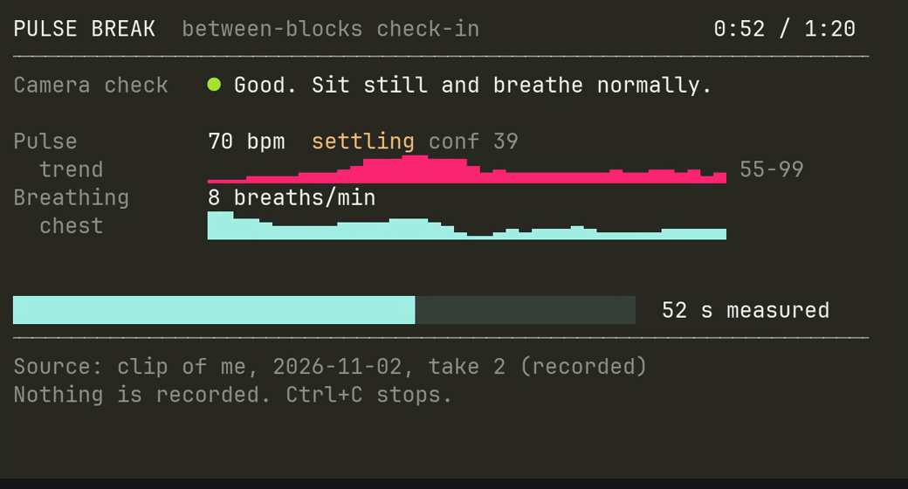

# Pulse Break

A 60-second check-in for the gap between two focus blocks. You look at your camera, the
[Presage SmartSpectra SDK](https://smartspectra.presagetech.com/docs) reads your pulse and
breathing rate from the video, and Pulse Break compares the result with your own recent
check-ins. If you are running clearly warmer than your usual, it suggests a five-minute break
before the next block. Otherwise it tells you to keep going.

It is a terminal app built on the SDK's Node.js binding. Everything it shows comes from the
SDK's live metrics while the check-in runs.

Demo video (runs on a recorded clip of me, see below): https://youtu.be/Xldyvg1omy0



## What you see

- **Camera check**: the SDK's own readiness message for every frame ("Face the camera.",
  "Hold still - motion"). The progress bar turns yellow while the SDK asks for an adjustment.
- **Pulse**: the latest pulse rate, whether the SDK marks it steady or still settling, its
  confidence, and a trend line with the range it covers.
- **Breathing**: the latest breathing rate and a trace of chest motion from the SDK's
  breathing waveform (the last 12 seconds).
- **At the end**: the median pulse (steady readings only) and median breathing rate, your
  usual from earlier check-ins, and one line of advice.

## Setup

Requirements: Node.js 20.12 or later on a platform the SDK ships for (macOS on Apple Silicon,
Linux x64 or arm64 with glibc 2.35+, Windows x64), a webcam, and a free Presage API key.

```bash
git clone https://github.com/Somach-Systems-Inc/pulse-break.git
cd pulse-break
npm install
cp .env.example .env
# put your key in .env: PRESAGE_API_KEY=...
```

Get the key at https://physiology.presagetech.com/auth/register (Dashboard, "Show API key").
The free tier has 100 credits, and one credit is 30 seconds of measurement, so a 60-second
check-in uses 2 credits.

## Use

```bash
node src/cli.mjs                 # 60-second check-in with your camera
node src/cli.mjs --seconds 90    # a longer one
node src/cli.mjs history         # your saved check-ins
node src/cli.mjs forget          # delete them
npm test                         # unit tests for the summary rules and the dashboard helpers
```

Sit facing the camera with your head and upper chest in frame, in even light, and stay still.
The first pulse value arrived after 12 to 22 seconds in my runs; breathing rate needs a few breaths.

### Testing without a camera

The SDK can read a video file instead of the camera, at the file's own frame rate:

```bash
node src/cli.mjs --video my-clip.mp4 --seconds 60
```

Only use a recording of yourself, or of someone who agreed to it. The SDK's framing check
wants room for the chest. A tight webcam crop (face and shoulders only) failed that check for
me ("Place more of the chest in view") and produced no readings. Adding a black band under
the frame let the check pass, and the pulse still comes from the face:

```bash
ffmpeg -i my-clip.mp4 -an -vf "fps=30,pad=iw:ih*1.5:0:0:black" -c:v libx264 -crf 16 my-clip-padded.mp4
```

## How the SDK is used

`src/session.mjs` is the whole integration:

- `new SmartSpectraSDK({ apiKey, requestedMetrics: [...breathingMetrics, ...cardioMetrics], enableTelemetry: false })`
- input: `useCamera(CameraSelection.default)`, or `useFile(path, { interframeDelayMs })` for a recording
- `validationStatus` drives the camera check line and the bar colour
- `metrics` packets are decoded with `decodeMetrics`; the app reads `cardio.pulseRate`
  (value, `stable`, confidence), `breathing.rate` and `breathing.upperTrace`, and shows
  `cardio.hrv` when the SDK sends it
- `processingStatus` and `error` end the session; a camera check-in stops itself with
  `stopAsync()` once the time is measured

`src/summary.mjs` holds the rules, as pure functions with tests:

- your usual = the median of your last 7 check-ins that had a reading (needs 2 earlier ones)
- "running warmer than usual" = pulse 10 bpm or more above your usual, or breathing 4 or
  more breaths per minute above it
- "calmer than usual" = clearly below on one signal (5 bpm or 2 breaths per minute) and not
  above on the other
- otherwise "close to your usual"

These thresholds are round numbers chosen to be easy to explain. They are not clinical
cut-offs, and Pulse Break makes no medical claims.

## Consent and data handling

- **Consent**: every check-in starts by saying what will be read (camera or a named file),
  for how long, and what is kept, then asks "Turn on the camera? [y/N]". The default is no.
  `--yes` skips the question for scripted runs where you already agreed. The camera is not
  opened before you answer.
- **Video**: frames go from the camera (or file) into the SDK inside this process. Pulse
  Break never writes frames, images or video anywhere.
- **What is stored**: one line per check-in in `~/.pulse-break/history.jsonl` (time, source
  label, median pulse, median breathing rate, how many readings, seconds measured). The
  folder is created with owner-only permissions. The SDK's own log messages go to
  `~/.pulse-break/sdk.log` (errors only; no frames).
- **Retention and deletion**: the history stays on your computer until you run
  `pulse-break forget` or delete the folder.
- **Sharing**: Pulse Break sends nothing anywhere itself. The SDK authenticates with Presage
  using your API key (Presage meters credits per account, so requests are tied to your
  account and device) and downloads the models it runs.
- **SDK telemetry**: off by default here (`enableTelemetry: false`). Presage's
  [telemetry notes](https://smartspectra.presagetech.com/docs/telemetry-and-privacy) say
  telemetry never attaches raw frames or measured values; with `--telemetry` the SDK sends
  its session summaries and readiness reports to Presage.
- **AI services**: none. The app does not call the SDK's optional insight feature or any
  other model service.

## The demo video

The demo runs on recorded footage, because I made it while away from my desk. The clip is
me talking to my laptop camera on 2026-11-02 (sound removed), padded as described above.
The two earlier check-ins in the demo history are also recorded clips of me (2026-09-07 and
another take from 2026-11-02), run through the same app.

The video was made from the app's own output: `--cast` records what the terminal showed,
`tools/retime_cast.mjs` puts each frame on the clip's clock (the SDK reads a file a little
slower than real time), and `tools/make_demo.sh` lays the terminal next to the footage the SDK
read. Nothing in the terminal panel was edited.

## Limits

- I have run it on recorded clips on macOS (Apple Silicon). The camera path uses the SDK's
  own camera input, but I have not yet run a live camera check-in.
- A check-in while talking gives a less settled breathing rate than one while sitting quietly.
- Your usual is only as good as your history; the first two check-ins just build it.

## License

MIT for this repository. The SmartSpectra SDK is Presage's, under its own license, and is
installed from npm.
